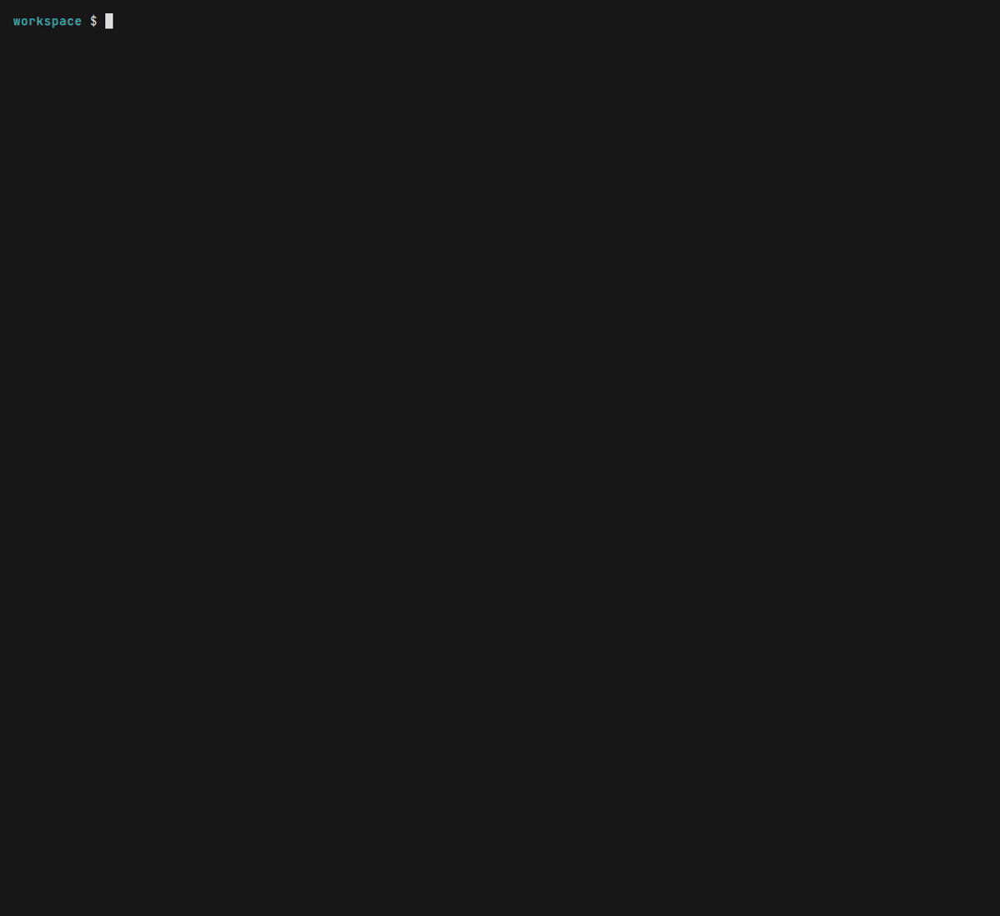

# viability-gate

**A second-opinion writing filter for a draft finding.** It reads the report. It does not decide that the bug is real, and a `CLEAR` is not a prediction that a program will pay, or that the report will avoid Informative, Duplicate, or out of scope.

For bug-bounty hunters, and for anyone using an AI to draft the report. One offline binary. No account, no API key, no network.

The public contest benchmark is a weak separator. On 0.7.0, a hard kill landed on 5.5% of paid Medium/High findings and 10.8% of invalid or won't-fix findings, and 12 of those 25 kills were paid. That is about twice as often on the unpaid side as on the paid side (1.8× on 0.6.0). [docs/benchmark.md](docs/benchmark.md) has both measurements. Do not read a kill as a verdict.

```bash
cargo install --git https://github.com/KhomDev/viability-gate
vg check finding.md
```

0.7.0 is not published to crates.io. Install from git, or `cargo install --path .` from a checkout. Rust 1.89 or newer if you build it. Release binaries need no Rust. Both `vg` and `viability-gate` are installed; they are the same program.

## Before and after

A real report, closed Informative as a duplicate of a published contest issue. Personal emails were not in the text. On 0.5.0, P7 held it: the matcher saw `best-practice` inside `rather than a best-practice observation`, and P18 did not see `accepted as Sherlock issue M-1`. This is what 0.7.0 prints on that report. `scripts/regen-readme-examples.sh` produces the block, and CI fails if it drifts.

<!-- BEGIN:example -->

```text
viability-gate 0.7.0  —  cmp-04.md

  OUTCOME   KILL
            A hard blocker fired. Do not submit as written.
  SCORE     60 / 100   (uncalibrated heuristic; not a probability; threshold 50)

  HARD  P18  Known characteristic documented in a prior audit
             ↳ matched: accepted as Sherlock issue
             ↳ in sentence: defect the protocol's own 2026-03 audit accepted as Sherlock issue M-1 and whose accepted fix never
             ↳ matched: accepted as Sherlock issue M-1
             ↳ in sentence: defect the protocol's own 2026-03 audit accepted as Sherlock issue M-1 and whose accepted fix never
             ↳ matched: previously-reported
             ↳ in sentence: credit): a known, previously-reported defect whose accepted fix never shipped to mainnet
             → Do not submit. Prior audit findings are part of the public record;
             → submitting a known design characteristic signals you did not read the
             → prior audit.
             (docs/rules/P18.md; evidence: in-sample; origin rows: 1)

  PASS  P1, P6, P12, P13, P2, P3, P5, P11, P20, P7, P16, P21, P22, P15, P4, P9, P8, P10, P14, P17, P19, P23, P24, P25
  SKIP  G1 (no ledger supplied)   G2 (no ledger supplied)   G3 (no scope tree supplied)   G4 (no prior-audit surface supplied)   G5 (no test suite supplied)   G6 (fork status unknown)   G7 (no own-history log supplied)   D1 (no known-issues corpus or prior-finding index supplied)   A1 (no target tree supplied)

  Gates:  G1 ?   G2 ?   G3 ?   G4 ?   G5 ?   G6 ?   G7 ?   D1 ?   A1 ?

  ────────────────────────────────────────────────────────────
  Advisory, never authoritative. This tool produces an outcome with reasons;
  it does not decide, and it cannot read your target's live rules.
  Over-filtering is its own failure mode - the catalog is a prioritiser, not
  a kill-switch. A triage rejection is not a final verdict. CLEAR means only
  that no known blocker was found by this tool.
```

<!-- END:example -->

P18 is the hard stop. P7 is in the pass list. P26 is not in this output: it is opt-in (`--severity-notes`) because on the 0.6.0 bench it fired on every report. Gate A1 is `?` because no `--target` was passed, and `?` is not a pass. The score is 100 minus the weights that fired. It is not a probability, and it does not mean the cited code was opened.



## Benchmark

220 paid Medium/High findings (110 Code4rena, 110 Sherlock) and 120 invalid or won't-fix findings, labels applied after `vg` ran. The selection rule and the per-rule table are in [docs/benchmark.md](docs/benchmark.md). Re-scored on 0.7.0 against the same manifest.

| Set | N | Hard KILL | Rate | 0.6.0 |
|---|---:|---:|---:|---:|
| Paid Medium/High | 220 | 12 | 5.5% | 8.6% |
| Invalid + won't-fix | 120 | 13 | 10.8% | 15.8% |
| Code4rena QA | 60 | 11 | 18.3% | 23.3% |
| Sherlock Low/Info | 60 | 9 | 15.0% | 16.7% |

A hard kill on this pair is right about half the time: 12 of 25 kills are paid findings (48%). The unpaid kill rate divided by the paid kill rate is about 2.0 (it was 1.8 on 0.6.0). That is a weak separator. Nine of the 12 paid kills are still P2. P3 no longer hard-kills on this set (7 paid fires, 0 of them hard). The in-sample recall further down is a different set and an older catalog.

## What you run

```bash
vg check finding.md
vg check finding.md --target repo --commit <sha>
vg check finding.md --funnel
vg check finding.md --severity-notes
vg check finding.md --ledger ledger.yaml --scope scope.txt --known-issues known.yaml --index index.yaml
vg import audit audit.yaml --out target/
vg import program saved-page.html --out target/
vg import prior audits/ --out target/
vg match finding.md --index target/index.yaml
vg gates --ledger ledger.yaml --scope scope.txt --finding finding.md
vg explain P18
vg bench --rejected rejected/ --accepted accepted/ --labels labels.csv
```

`vg import` reads local files only: an engagement `audit.yaml`, a program page you saved, or prior-audit markdown and PDF. It writes the ledger, the scope list, and the known-issues file, and it says in `IMPORT-NOTES.md` what it did not find. It does not invent a regex. Schema: [docs/import.md](docs/import.md).

`vg match` and `--index` rank a draft against prior findings by code identifiers (function names, paths), not by word overlap. The author measured vocabulary overlap at about 0.024 and it did not separate duplicates. The fail line is a stated threshold, not a fitted one. [docs/duplicate-matching.md](docs/duplicate-matching.md).

A `finding.yaml` next to the report, or `<name>.finding.yaml`, can record `attacker`, `victim`, `preconditions`, `impact_usd`, `severity_rule_quoted`, `prior_audit_check`, `duplicate_check`, and `status`. Filled claim fields suppress the matching note when that note runs. A sentence that says the prior-audit check was done does not suppress P18.

## Citation anchor

`vg check finding.md --target <checkout> --commit <hex-sha>` reads the tree at that commit. Every source path cited in the prose (not inside a fenced block, and not under a test, script, or dependency directory) has to exist. A cited line has to be in range. A function named in the same sentence has to be in that file. A miss is gate A1 failing and a hard `CITE` finding, so the score is not 100 and the outcome is not `CLEAR` or `INCOMPLETE`. `--funnel` does not route `CITE`. A known-issue match stays a kill too.

Without `--target`, A1 is unknown. The prose score does not change, because nothing was opened. Without `--commit`, a location that exists in the working tree is still not a pass.

The check does not compare a quoted snippet byte for byte, and it does not prove the function is reachable from an external entry point.

## Funnel mode

`vg check finding.md --funnel` is the audit-operator setting. Claim-heuristic hard rules (`P1`–`P26`) become **ROUTE-TO-VERIFY** instead of **KILL**. The rule is still listed, and its weight still comes off the score. `--fail-on-kill` does not fail on a route.

P2 and P3 are also softer with the flag off. "No one but the admin can…" is a privilege claim and kills. An unprivileged yield theft that mentions an owner setting a parameter, or front-running, does not die for those words. A bare "front-run" holds. "Front-run-only" and "operator delay" still kill, and `--funnel` turns that kill into a route.

P26 does not run unless `--severity-notes`. It fired on every item of the 0.6.0 bench and was not a signal.

## What it checks

**26 entries, P1–P26**, plus gates G1–G7, D1, and A1. The catalog is [rules/anti-patterns.yaml](rules/anti-patterns.yaml). One page per rule is generated into [docs/rules/](docs/rules/).

P1–P22 are the rejection shapes (privileged role, best-practice, prior audit, no attacker-win, headline contradicted by the proof, and the rest). P23–P25 are weight-0 notes. P26 is the same kind of note and is opt-in. A weight-0 note does not hide a gate that could not run.

| # | Condition | Outcome |
|---|---|---|
| 1 | a structured hard finding (known-issue match, or `CITE`) | **KILL** |
| 2 | a claim-heuristic hard rule, with `--funnel` | **ROUTE-TO-VERIFY** |
| 3 | a claim-heuristic hard rule, without `--funnel` | **KILL** |
| 4 | any soft rule, any failed gate, or score under the threshold | **HOLD** |
| 5 | any warn rule with weight | **NOTE** |
| 6 | any gate `?` | **INCOMPLETE** |
| 7 | only weight-0 notes, and every gate ran | **NOTE** |
| 8 | otherwise | **CLEAR** |

There is no `SUBMIT`. `CLEAR` means no known blocker was found by this tool. The score is 100 minus the weights of the fired rules. It is not a probability. Gates do not subtract from it.

## Limits

Read these before trusting a `CLEAR`.

**Name collision.** `vg` is also an unrelated bioinformatics tool. This crate ships `vg` and `viability-gate`. Use whichever is not already on your `PATH`. [docs/install.md](docs/install.md).

**In-sample, and of an older catalog.** The original measurement was 59 of 97 logged rejections, scored on the catalog as it stood for 0.2.0. The log has since grown, and 0.3.0, 0.5.0, and 0.6.0 changed rules. That study has not been re-run. The source texts are private.

| Scoring | Result |
|---|---:|
| **Strict** — flagged the gate that actually decided it | **14/59 (23.7%)** |
| **Lenient** — flagged any gate-mapped reason to stop | **45/59 (76.3%)** |
| Miss — no gate-mapped reason at all | 14/59 |

The 52-point gap is the summary: good at saying stop, bad at saying why. The rules were derived from the same log, so 23.7% is closer to a ceiling than to an unbiased estimate. [docs/calibration.md](docs/calibration.md).

**The author's log has no paid findings.** The false-positive rate on that log is unmeasured. The public contest numbers above are the measurement the public data can support. They are not a substitute. [docs/control-set.md](docs/control-set.md).

**Heuristic text, plus one anchor.** The P-rules are regexes or small structural checks over prose. They can be talked out of a true hit by rewording, and they cannot see a duplicate you did not put in the index. A1 is the exception: with `--target` and `--commit` it opens the cited file. It still does not run a proof of concept. Negation handling, and where it still fails, is [docs/negation-audit.md](docs/negation-audit.md).

**Path arguments.** A path, commit, or id that starts with `-` is rejected. Pass `--` before positional findings. This crate has no MCP server. The check is here so a caller cannot put `--rules` or another option where a path was expected.

**G6 has no supporting rows.** No rejection in the author's log was decided by fork provenance.

**`origin_rows` is provenance, not a detection rate.** It counts rows of the public rejection dataset. Rules with no public token carry 0 and `evidence: none`. That is a refusal to publish a number that cannot be reproduced, not a claim of zero support.

**A HOLD is advice.** The researcher still decides.

## Related

- [data/rejection-taxonomy/](data/rejection-taxonomy/) — the public log this catalog is derived from, snapshotted from [rejection-taxonomy](https://github.com/KhomDev/rejection-taxonomy) v0.6.0 (code MIT, data and prose CC BY 4.0). Which buckets the catalog can reach, against the `earliest_gate` column of that snapshot:

  | Reachable bucket | Rows | Rules that reach it |
  |---|---:|---|
  | `G2_exclusion_clause` | 20 | P2, P3 |
  | `design_review` | 13 | P1, P13 |
  | `G4_prior_audit` | 7 | P18 |
  | `P17_no_attacker_win` | 14 | P17 |
  | `G1_severity_floor` | 5 | P16 |
  | `G3_scope_tree` | 4 | P5 |
  | `REALISM` | 3 | P6, P11, P21, P22 |
  | `P16_below_floor` | 2 | P16 |
  | `G5_test_intent` | 1 | P15 |
  | `program_ceiling` | 1 | (P16's severity-floor class) |
  | `P19_headline_mismatch` | 1 | P19 |
  | `P20_cooperating_party` | 1 | P20 |
  | **reachable total** | **72** | |

  `D1_duplicate_check` is 41 rows and is not reachable from the finding's prose alone. "Can reach" means a rule maps to that bucket. It is not a recall figure.

  ```bash
  python scripts/check_readme.py --require-dataset
  ```

  The CSV is `data/rejection-taxonomy/data/rejections.csv`. `SOURCE.md` in that directory records the tag and the commit.

- [data/bounty-economics/](data/bounty-economics/) — the ledger schema and the tier and clause taxonomies behind G1, G2, and `vg import`, snapshotted from [bounty-economics](https://github.com/KhomDev/bounty-economics) v0.5.0 (MIT). Schema: `data/bounty-economics/schemas/ledger.schema.json`.
- [realism-gate](https://github.com/KhomDev/realism-gate) — a static checker for the proof, after this one
- [examples/bench/](examples/bench/) — the synthetic bench fixture. It proves the harness runs. It measures nothing about the world.
- [docs/rules/](docs/rules/) — generated page per rule

Pin to a tag, not to `main`:
[viability-gate v0.7.0](https://github.com/KhomDev/viability-gate/tree/v0.7.0).

## License

MIT, the whole repository, including `rules/` and `docs/`. The catalog is original work derived from the author's rejection log. The classified log is published separately and this licence does not change its terms.

No bundled program data. Target ledgers, scopes, indexes, and history files are yours. `eval/` commits URLs and scores, not report text. See [docs/licensing.md](docs/licensing.md).
